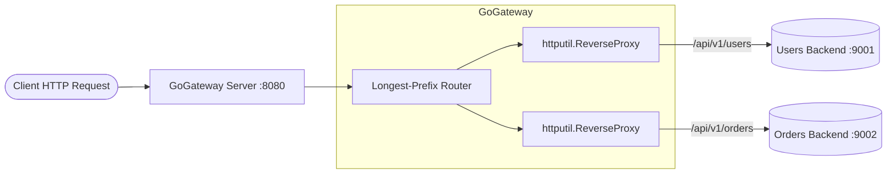

# GoGateway

A lightweight, production-grade Layer-7 Reverse Proxy and Load Balancer written in Go.

## Architecture (Phase 1)



## Quick Start

```bash
# Run unit tests
go test -v ./...

# Start the gateway
go run ./cmd/gateway -config configs/gateway.yaml
```

## Configuration Reference

| Field                        | Type       | Default   | Description                                                            |
| :--------------------------- | :--------- | :-------- | :--------------------------------------------------------------------- |
| `server.listen_addr`         | `string`   | `":8080"` | TCP address for the proxy server to listen on.                         |
| `server.read_timeout`        | `duration` | `5s`      | Maximum duration for reading the entire request.                       |
| `server.read_header_timeout` | `duration` | `2s`      | Amount of time allowed to read request headers (Slowloris protection). |
| `server.write_timeout`       | `duration` | `10s`     | Maximum duration before timing out writes of the response.             |
| `server.idle_timeout`        | `duration` | `60s`     | Maximum time to wait for the next request on keep-alive connections.   |
| `server.shutdown_timeout`    | `duration` | `10s`     | Maximum time to drain active connections during graceful shutdown.     |
| `routes[].name`              | `string`   | Required  | Unique identifier for the route.                                       |
| `routes[].path_prefix`       | `string`   | Required  | URL path prefix (must start with `/`).                                 |
| `routes[].target_url`        | `string`   | Required  | Upstream backend URL (`http://` or `https://`).                        |
| `routes[].strip_prefix`      | `bool`     | `false`   | Strip `path_prefix` from outbound URL path before forwarding.          |
