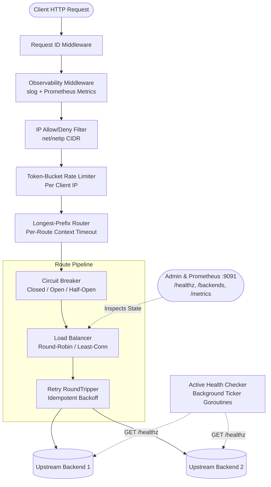

# GoGateway

[](https://github.com/mhdridwannst/Gogateway/actions/workflows/ci.yml)
[](https://goreportcard.com/report/github.com/mhdridwannst/Gogateway)

A lightweight, high-performance Layer-7 HTTP Reverse Proxy and Load Balancer written in idiomatic Go. Built primarily with the Go standard library (`net/http`, `net/http/httputil`, `log/slog`, `sync/atomic`, `net/netip`) and designed for cloud-native environments.

---

## Key Features

- **Layer-7 Reverse Proxy**: Longest path-prefix routing on clean segment boundaries, optional prefix stripping, and anti-spoofing `X-Forwarded-*` header rewriting via `httputil.ReverseProxy.Rewrite`.
- **Load Balancing**: Lock-free **Round-Robin** and **Least-Connections** algorithms powered by `sync/atomic`.
- **Dual Health Checking**:
  - **Active Probing**: Background goroutine pool probing upstream endpoints per route at configurable intervals.
  - **Passive Observation**: Real-time failure detection on network dial errors and upstream `5xx` responses.
- **Resilience & Protection**:
  - **Token-Bucket Rate Limiting**: Per-client-IP rate limiting with lazy token calculation and background TTL eviction.
  - **Circuit Breaker**: Three-state machine (`Closed` $\rightarrow$ `Open` $\rightarrow$ `Half-Open`) preventing cascading upstream failures.
  - **Retries with Exponential Backoff**: Custom `http.RoundTripper` retrying idempotent requests (`GET`, `HEAD`, `PUT`, `DELETE`, `OPTIONS`) on transient network errors.
  - **IP Allow/Deny List**: High-speed IPv4/IPv6 and CIDR filtering using zero-allocation `net/netip`.
- **Observability**:
  - **Prometheus Metrics (`/metrics`)**: Request counters and latency histograms isolated in a custom registry.
  - **Structured Logging (`log/slog`)**: JSON/Text access logs correlated with 128-bit cryptographic `X-Request-ID` headers.
  - **Admin Inspection API (`/backends`, `/healthz`)**: Dedicated admin listener on `:9091` exposing live pool health and active connection counts.
- **Production Delivery**: Multi-stage non-root Dockerfile (`UID 10001`), Docker Compose stack with Prometheus, Kubernetes manifests, and GitHub Actions CI with `-race` detection.

---

## Architecture



---

## Quick Start

### 1. Run with Docker Compose (Recommended)

Spins up `gogateway` (`:8080` and `:9091`), three upstream echo backends (`users-1`, `users-2`, `orders-1`), and Prometheus (`:9090`):

```bash
docker compose up --build -d

# Test round-robin load balancing across users-1 and users-2
curl -i http://localhost:8080/api/v1/users/profile
curl -i http://localhost:8080/api/v1/users/profile

# Inspect live backend pool health and active connections
curl -s http://localhost:9091/backends | jq .

# Inspect Prometheus metrics
curl -s http://localhost:9091/metrics | grep gateway_http

# Tear down stack
docker compose down
```

### 2. Build & Test Locally

```bash
# Run unit tests
go test -v ./...

# Run unit tests with data race detector (requires CGO/gcc)
go test -v -race ./...

# Run performance benchmarks
go test -bench=. -benchmem ./internal/...

# Run gateway locally
go run ./cmd/gateway -config configs/gateway.yaml
```

---

## Configuration Reference (`configs/gateway.yaml`)

| Key                           | Type       | Default         | Description                                                      |
| :---------------------------- | :--------- | :-------------- | :--------------------------------------------------------------- |
| `server.listen_addr`          | `string`   | `":8080"`       | Public proxy listen address.                                     |
| `server.read_timeout`         | `duration` | `5s`            | Maximum duration for reading the entire request.                 |
| `server.read_header_timeout`  | `duration` | `2s`            | Time allowed to read request headers (Slowloris protection).     |
| `server.write_timeout`        | `duration` | `10s`           | Maximum duration before timing out response writes.              |
| `server.idle_timeout`         | `duration` | `60s`           | Maximum keep-alive idle connection time.                         |
| `server.shutdown_timeout`     | `duration` | `10s`           | Graceful shutdown connection draining deadline.                  |
| `admin.enabled`               | `bool`     | `false`         | Enable internal admin/observability HTTP server.                 |
| `admin.listen_addr`           | `string`   | `":9091"`       | Listen address for `/healthz`, `/backends`, and `/metrics`.      |
| `logging.level`               | `string`   | `"info"`        | Minimum log level (`debug`, `info`, `warn`, `error`).            |
| `logging.format`              | `string`   | `"json"`        | Output format (`json` or `text`).                                |
| `ip_filter.allow_list`        | `[]string` | `[]`            | Allowed client IPs or CIDR ranges (empty allows all).            |
| `ip_filter.deny_list`         | `[]string` | `[]`            | Blocked client IPs or CIDR ranges (takes precedence over allow). |
| `rate_limit.enabled`          | `bool`     | `false`         | Enable per-client-IP token-bucket rate limiting.                 |
| `rate_limit.requests_per_sec` | `float64`  | `20`            | Token refill rate per second per IP.                             |
| `rate_limit.burst`            | `int`      | `40`            | Maximum token bucket capacity per IP.                            |
| `routes[].name`               | `string`   | Required        | Unique identifier for the route.                                 |
| `routes[].path_prefix`        | `string`   | Required        | URL path prefix (must start with `/`).                           |
| `routes[].strategy`           | `string`   | `"round_robin"` | Load balancing strategy (`round_robin` or `least_conn`).         |
| `routes[].strip_prefix`       | `bool`     | `false`         | Strip `path_prefix` before forwarding to upstream.               |
| `routes[].timeout`            | `duration` | `5s`            | Per-request upstream context timeout.                            |
| `routes[].retries`            | `int`      | `0`             | Max retry attempts on idempotent transport errors.               |
| `routes[].retry_backoff`      | `duration` | `50ms`          | Base exponential backoff duration between retries.               |
| `routes[].backends`           | `[]string` | Required        | List of upstream backend URLs (`http://` or `https://`).         |

---

## Benchmarks

Executed via `go test -bench=. -benchmem ./internal/...` on `AMD Ryzen 3 7320U with Radeon Graphics (8 logical CPUs), Windows amd64`:

| Benchmark                         | Iterations   | Latency (`ns/op`) | Memory (`B/op`) | Allocations (`allocs/op`) | Notes                                             |
| :-------------------------------- | :----------- | :---------------- | :-------------- | :------------------------ | :------------------------------------------------ |
| `BenchmarkRoundRobinNext-8`       | `62,656,641` | `18.77 ns/op`     | `0 B/op`        | `0 allocs/op`             | Lock-free `atomic.Uint64` backend selection       |
| `BenchmarkRateLimiterAllow-8`     | `19,296,699` | `66.13 ns/op`     | `0 B/op`        | `0 allocs/op`             | Mutex-guarded lazy token-bucket refill            |
| `BenchmarkGatewayProxyEndToEnd-8` | `27,774`     | `51,732 ns/op`    | `40,466 B/op`   | `92 allocs/op`            | Full HTTP router + load balancer + TCP round-trip |

---

## Current Limitations & Non-Goals (MVP Scope)

1. **No TLS/ACME Termination**: Designed to run behind an edge TLS terminator (e.g., AWS ALB, Cloudflare, or Kubernetes Ingress Controller) or terminate TLS via a future listener upgrade.
2. **Static Configuration**: Routes are loaded at startup and validated strictly (`fail-fast`). Hot reloading via `SIGHUP` or `fsnotify` is intentionally omitted from the MVP.
3. **In-Memory Rate Limiting**: Token buckets are stored in local process memory. In a multi-replica deployment (`replicas > 1`), rate limits apply per gateway pod rather than globally across a Redis cluster.
